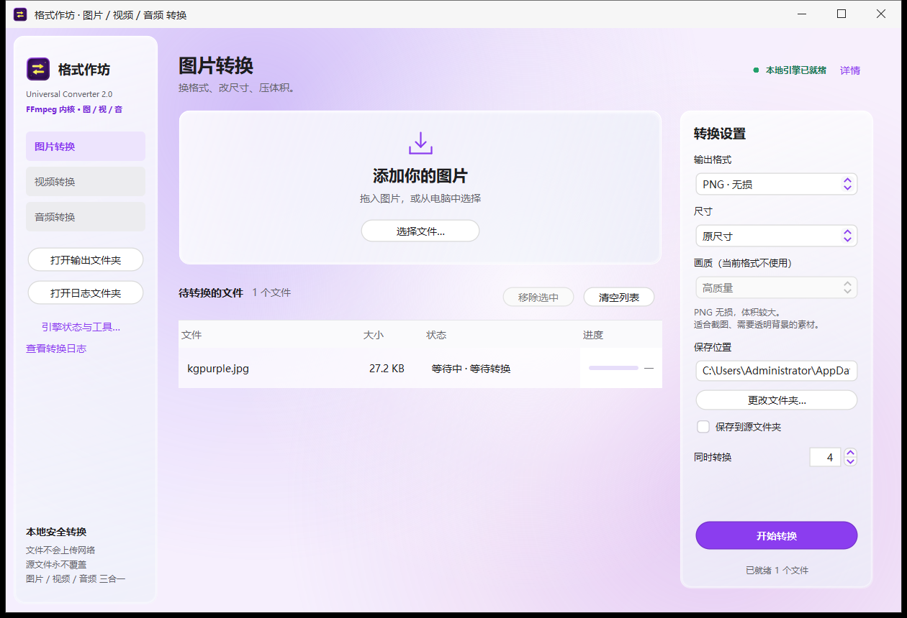

# 格式作坊 · Format Workshop

> 当前版本 2.3.9（2026-11）· [下载安装包](https://github.com/newbeefish/format-workshop/releases/latest)

一个纯本地运行的 Windows 图形化格式转换工具，界面用 Java Swing + FlatLaf 手写（紫色主题、玻璃拟态），
内核全部走 **FFmpeg**，另外内置酷狗 / 网易云 / QQ 音乐加密格式的解密能力。

四个板块：**图片 / 视频 / 音频 / 杂项**。拖进去就能转，不联网、不上传、不覆盖原文件；
不知道自己的文件是什么也没关系——会把文件认出来并送到对的板块（见「自动认文件」）。



## 功能总览

| 板块 | 能做什么 | 数量 |
|---|---|---|
| 图片 | 换格式、改尺寸、压体积；同格式直接复制 | 输出 24 种 |
| 视频 | 换容器、换编码、改分辨率；不想转码就只换壳；可以用显卡编码 | 16 容器 × 11 编码（+ 原样复制） |
| 音频 | 换格式；换容器不重编码；自动解密音乐平台加密格式 | 输出 25 种 |
| 杂项 | 压缩打包、PDF / 图片互转、图片伪装、哈希 / Base64 / 二维码 / 改名、汇编 / ISO / APK | 31 个操作 |

---

## 图片

- **输入**：FFmpeg 能解的都能收（jpg / jpeg / png / webp / gif / bmp / tif / tiff / **ico** / tga / psd / dds / exr / jp2 / ppm / pgm / pbm / pnm / pcx / **heic** / **heif** / **avif** …）；
  扩展名不在表里时现场用 `ffmpeg -i` 探一下，能解就收
- **HEIC / HEIF / HIF 专门处理**：FFmpeg 本身不解 HEIC，程序先调内置的 `heif-dec.exe` 转成 PNG，再交给 FFmpeg
- **输出 24 种**：PNG、JPG/JPEG、WEBP、BMP、TIFF/TIF、TGA、PPM、PGM、PBM、PCX、EXR、HDR、JP2、J2K、DPX、QOI、SGI、SUN、XBM、PAM、PFM、AVIF
  - 列表是启动时读 `ffmpeg -encoders` 过滤出来的，本机真写不出来的格式不会出现（HEIC/HEIF 没有 muxer，所以只在输入端支持；
    PSD、XPM、DDS 这类只有解码器没有编码器的，也不会出现在输出里）
- **尺寸**：原尺寸 / 最大边 1920 / 最大边 1280 / 最大边 800 / 缩小一半（只缩不放，保持比例）
- **画质**：高质量 / 标准 / 小体积（JPG、WEBP 生效：JPG q=2/5/9，WEBP quality=92/82/68，其余格式忽略）
- **同格式直接复制**：目标格式和源文件一样、又没改尺寸时，直接把文件拷过去，不重新压一遍（JPG→JPG 不损失画质）
- 一张图一个结果；GIF 动图请用视频板块

## 视频

- **输入**：mp4 / mkv / avi / mov / webm / flv / wmv / ts / m2ts / m4v / mpg / vob / rmvb / mxf / nut / 3gp / ogv / dv …（同样支持任意 FFmpeg 能读的容器，不限于列表里的扩展名）
- **容器和编码分开选**：
  - **容器 16 种**：MP4 / MKV / MOV / WEBM / AVI / FLV / WMV / TS / M2TS / MPG / 3GP / OGV / MXF / NUT / DV / GIF
  - **编码 12 项**：原样复制 + 11 种编码（H.264、H.265/HEVC、VP9、AV1、MPEG-4、MPEG-2、ProRes、WMV2、Theora、DV、GIF）
  - 换了容器只列它支持的编码；每一项都写了优缺点（「H.264 · 兼容最广 · 硬解普遍」这类）
- **能只换壳就不重编码**（编码默认就是「原样复制 · 不重编码（最快）」）：
  - TS / M4S / MKV / MP4 互换、HEVC 保持 HEVC、MKV→MP4、AVI(MPEG-4+MP3)→MP4 这些直接 `-c copy`，几秒完成、画质零损失
  - 容器装不下源编码时才退回重编码（例如 VP9 塞进 MP4、H.264 塞进 WEBM），日志里会写原因
  - 音轨单独判断：MKV(H.264+FLAC)→MP4 会「视频直封装 + FLAC 重编码成 AAC」，只有一条音轨需要转
  - 封装时自动补 `-fflags +genpts`、`-avoid_negative_ts make_zero`（分片流/TS 换壳不出现时间戳错乱），MP4 系列再加 `-movflags +faststart`
- **可以用显卡编码**：窗口上方「编码：CPU / 显卡」开关（默认 CPU）
  - 依次尝试 NVENC（NVIDIA）→ Quick Sync（Intel）→ AMF（AMD）→ D3D12，**真跑一次 0.4 秒试编码**通过才亮起来
  - 开起来以后 H.264 / H.265 / AV1 走显卡，解码也走 `-hwaccel auto`；显卡不支持的编码（MPEG-4、MPEG-2、ProRes、Theora、WMV、GIF）仍走 CPU
  - 显卡编码失败会自动删掉半成品、换 CPU 参数重跑一次，不会给坏文件
  - 用不了时按钮置灰点不动，鼠标停上去直接给原因（例如「NVENC：Driver does not support the required nvenc API version」）
- **分辨率**：原尺寸 / 1080p / 720p / 480p（选非原尺寸一定重编码，缩放没法 copy）
- **画质**：高质量（x264 CRF 18、VP9 24）/ 标准（23 / 32）/ 小体积（28 / 40）；显卡编码对应 CQ/QP 20 / 24 / 29
- **GIF**：只在视频板块提供，按 12 帧/秒抽帧、无声音；GIF 目标没有「原样复制」这个选项（必须重编码）
- 视频轨只取第一条，**音轨全部保留**（容器支持多音轨时）；字幕不保留

## 音频

- **输入**：mp3 / mp2 / wav / flac / aac / m4a / alac / ogg / oga / opus / wma / ape / aiff / ac3 / eac3 / dts / amr / au / mka / tta / spx / caf / w64 / gsm / voc … 以及任意 FFmpeg 能解的音频
- **输出 25 种**：MP3、WAV、FLAC、AAC、M4A、OGG、OPUS、WMA、AIFF、AC3、EAC3、MP2、AMR、AU、MKA、TTA、SPX、CAF、M4B、W64、GSM、VOC、AIF、AIFC、OGA
  - 每种格式后面带一句短介绍（MP3 · 通用音频 / FLAC · 无损音频 / OPUS · 低码率强 …），右侧还列优缺点
- **容器里可选编码**（选了具体编码就重编码，选「原样复制」就只封装）：
  | 容器 | 可选编码 |
  |---|---|
  | M4A | AAC · 有损 / ALAC · 无损 |
  | MKA | FLAC · 无损 / AAC · 有损 / Opus · 低码率强 |
  | OGG | Vorbis · 兼容最好 / Opus · 同码率更小 |
  | WAV | PCM 16bit / PCM 24bit |
  | AIFF | PCM 16bit 大端 / PCM 24bit 大端 |
  | CAF、W64 | PCM 16bit / PCM 24bit |
- **换容器不重编码**：AAC→M4A / MKA、Opus→OGG、FLAC→MKA 这类直接封装；FLAC→MP3、AAC→MP3 这种容器装不下的才重编码
- **MP3 → MP3 无损直出**：源就是 MP3 又选了 MP3，直接拷文件，不重新编码
- **音质**：高质量（`-q:a 0`）/ 标准（`-q:a 2`）/ 省空间（`-b:a 128k`），只对 MP3 生效
- **视频抽音轨**：把视频文件拖进音频板块就行（状态里会标「会抽音轨」），不用先转一遍视频
- **加密音乐自动解密**：
  - 酷狗：`.kgg` `.gkk` `.kgm` `.kgma` `.kge` `.kgtemp` `.vpr`
  - 网易云：`.ncm`
  - QQ 音乐：`.qmc0` `.qmc2` `.qmc3` `.qmcflac` `.qmcogg` `.mflac` `.mflac0` `.mflach` `.mgg` `.mgg0` `.mgg1` `.mggl`
- 元数据和封面在重编码时尽量保留；MP3 输出会写 ID3v2.3 + ID3v1

## 杂项

第四个板块，处理“不是媒体”的文件，按右上角分成四类，共 31 个操作。

**拖进来自动认文件**：杂项默认停在「打包为 ZPAQ」，但丢进来的东西会先认一遍，归档 / 文档 / 图片都不再被误压一遍：

| 丢进来的文件 | 自动切到 |
|---|---|
| `.zip` / `.jar` / `.7z` / `.tar.gz` / `.xz` / `.tar.xz` / `.zpaq` | 对应的「解压 / 解包」操作 |
| `.pdf` | PDF 拆成图片 |
| 图片（jpg / png / heic / avif / webp …） | 图片合成 PDF |
| 图片里藏着压缩包（尾部有 ZIP） | 从图片里取出内容 |
| `.apk` / `.asm` / `.sha256` / `.md5` / `.b64` | APK 签名 / 汇编编译 / 校验哈希 / Base64 解码 |
| 视频、音频 | 不是杂项能处理的，直接切到视频 / 音频板块 |
| `.rar` | 会明确说「暂不支持 RAR，请先用别的工具解开」 |

认出要换操作时会弹一句说明，告诉你它是什麼、换成了哪个操作；已经手动选了某个工具（哈希、改名、改时间…）时不会被抢走。

**压缩打包**
- **打包 / 解压 ZIP**：任何文件 / 文件夹 → `.zip`，`.zip` → 文件夹（解压自动防路径穿越，解到 `原名_解压`）
- **打包 / 解压 TAR.GZ**：任何文件 / 文件夹 → `.tar.gz`（Linux 友好），也能解 `.tar`、`.tgz`、`.gz`
- **打包 / 解包 7Z**：LZMA2，比 ZIP 更小
- **打包 / 解包 XZ**：单文件 LZMA2
- **打包 / 解包 JAR**：带 `META-INF/MANIFEST.MF`，也能当 zip 解开（解到 `原名_jar`）
- **打包 / 解包 ZPAQ**：走内置 `zpaq64.exe`（解到 `原名_zpaq`）
- **压缩格式互转**：ZIP / 7Z / TAR.GZ / TAR.XZ / JAR 之间互转，右侧选目标格式；`.jar` `.7z` `.xz` 都能直接拖进来
- **试 ZPAQ 密码**：给忘了密码的 `.zpaq` 用
  - 填数字范围（起 ～ 止，两端都算）、可选前缀 / 后缀、可选补零位数（填 4 就是 0001…）
  - 用 zpaq 自己逐个验证，找到就弹窗提示并写出 `原名_密码_1234.txt`
  - 只枚举纯数字；8 线程约 150～200 个/秒，1 万个数字约 1 分钟

**文档与图片**
- **图片合成 PDF**：JPG/PNG/BMP/GIF/TIFF/WEBP → 每张图单独一个 `.pdf`（按原图尺寸成页）
- **PDF 拆成图片**：每页导出 PNG 或 JPG（150 DPI），输出到文件夹
- **图片伪装成 ZIP（双面文件）**：一张正常的 PNG / JPG，尾巴里塞一个压缩包
  - 先在「载体图片」里选一张图（随便什么图），再把要藏的文件 / 文件夹丢进队列，点「开始处理」
  - 输出沿用载体图片的名字和格式：**双击看还是那张图**，把后缀改成 `.zip` 就能解压出发出去的东西
  - ZIP 内部偏移按 `zip -A` 的做法整体后移过，所以 Windows 资源管理器、7-Zip、Java 都能正常解，不是“只能本程序解”的玩具
  - 发的时候要用「文件」方式发，别用「图片」方式——聊天软件会重新压缩图片，尾巴会被剪掉
- **从图片里取出内容**：反过来用，把藏在图片尾部的压缩包解开（原图片不动，照常能看）

**校验与文本**
- **计算哈希**：SHA-256 / MD5，结果写成 `原名.sha256`
- **校验哈希**：把 `.sha256` / `.md5` 文件拖进来，自动找同名原文件比对，结果写在状态列
- **Base64 编码 / 解码**：输出 `原名.b64` / 还原原文件
- **生成二维码**：在“参数”里填内容（不填就用文件名），输出 `qr.png`（512×512）
- **识别二维码**：从图片里读出内容，输出同名 `.txt`
- **批量重命名**：输出到新目录，加三位序号前缀（`001_原名`），原文件不动
- **改修改时间**：就地把修改时间改成当前时间

**开发工具**
- **汇编编译**：用 NASM 把 `.asm` 编成 `.obj`（win64 格式）
- **ISO 打包**：把文件夹做成 ISO9660 镜像（Windows 双击即可挂载）
- **解包 ISO**：把 ISO 里的文件导出（不支持 UDF 盘）
- **挂载 ISO**：调用 Windows 自带光盘驱动挂载，挂上后自动打开盘符
- **APK 签名**：keystore + 别名 + 密码，可勾选 v1 / v2 / v3、可先 zipalign 对齐，用官方 `apksigner.jar` + `zipalign.exe`，输出 `原名-signed.apk`

压缩、哈希、二维码、Base64、PDF 全在 Java 里做（commons-compress / XZ / ZXing / PDFBox 都打进了 jar），
只有 ZPAQ、NASM、ISO 挂载、APK 签名会调用 `app\tools\` 里的程序。

## 界面与操作

- **布局**：左侧板块导航（图片 / 视频 / 音频 / 杂项 + 打开输出文件夹 / 打开日志文件夹 / 引擎状态 / 查看日志），
  中间拖放区 + 待处理列表，右侧是当前板块的设置和「开始转换」
- **拖放**：文件、文件夹都能拖；也可以点「选择文件…」；文件夹只收该板块支持的扩展名
- **四个板块都会自动认文件**（雑项里还认归档/文档）：先用文件头（PNG/JPEG/GIF/WebP/ISO-BMFF 品牌/EBML/RIFF/ID3/MPEG-TS/ZIP/7z/RAR/7z/XZ/ZPAQ/PDF/ISO…）判大类，
  再跑一次 `ffmpeg -i` 补编码、分辨率、时长；不属于当前板块的会自动切过去并告诉用户：
  - `.webm` 拖进图片板块 → 认出是视频，切到视频板块并加进队列
  - 压缩包 → 提示去「杂项 → 解包」
  - 视频拖进音频板块 → 留在音频板块（本来就是抽音轨），状态标「会抽音轨」
  - 完全认不出的 → 说明「FFmpeg 也读不出内容」，不会只丢一句“格式不支持”
- **列表里能看到它是什么**：状态列形如「视频 · 1920×1080 · 03:21 · H.264 + AAC」、「音频 · 04:13 · FLAC」；
  转换时这一列变成进度百分比
- **保存位置**：默认 `output` 文件夹，可以改，也可以勾「保存到源文件夹」；同名文件自动加 ` (2)` 后缀，不覆盖
- **同时转换**：并发数默认等于本机逻辑核心数，可下调（每个文件一个 FFmpeg 进程）
- **取消**：转换中可以取消，正在跑和排队中的都会停下
- **汇总**：列表上方显示「N 个文件」，右侧显示「已就绪 N 个文件」→ 转换中「正在本地处理… 45%」→ 完成后「已完成 N / N · 100%」「完成 X · 失败 Y」
- **引擎状态与工具…**：看 FFmpeg / 各解密工具 / 酷狗数据库 / QQ 音乐凭据 / 显卡探测结果，可以「刷新环境」
- **查看转换日志**：当前板块最近一次转换的完整 FFmpeg 输出，也能直接打开日志目录
- **右键菜单**：安装后首次启动写入 HKCU，右键文件 / 文件夹 / 文件夹空白处出现「用 格式作坊 转换 → 转为图片 / 转为视频 / 转为音频」，不需要管理员
- **单实例**：程序已经开着时，从右键菜单或再双击进文件，会转交给现有窗口，不会开第二个
- 窗口默认 1330×880，最小 1140×780

## 命令行

`格式作坊.exe` 直接带参数也能用（右键菜单就是调它）：

```text
格式作坊.exe <文件或文件夹>...            按扩展名自动选板块后打开
格式作坊.exe --image <文件>...            强制用图片板块
格式作坊.exe --video <文件>...            强制用视频板块
格式作坊.exe --audio <文件>...            强制用音频板块（视频也行，会抽音轨）
格式作坊.exe --diagnose                   只做环境自检并打印结果（脚本/排障用）
```

`--diagnose` 输出 `ffmpeg / kgg-dec / unlockKuGoWin / ncmdump / kugouDb` 的探测结果，退出码 0 表示 FFmpeg 就绪。

## 从源码构建

需要 JDK 17+（开发时用的是 JDK 25）、FFmpeg，打安装包还需要 WiX（3 的 candle/light 或 4/5 的 wix.exe 都认）。

```powershell
# 1. 编译
javac -encoding UTF-8 --release 17 -cp "path\to\flatlaf.jar" -d build src\cn\gkkstudio\*.java

# 2. 打 jar（需要把 FlatLaf 的 classes、图标、mask 一起放进去，见 manifest.txt）
jar --create --file GkkAudioStudio.jar --manifest manifest.txt -C stage .

# 3. 生成 app-image / 安装包
jpackage --type exe --name "格式作坊" --app-version 2.3.5 `
  --input installer-input --main-jar GkkAudioStudio.jar --main-class cn.gkkstudio.GkkMp3App `
  --icon format-converter.ico --runtime-image runtime --dest dist `
  --win-dir-chooser --win-menu --win-shortcut
```

`--type msi` 只出 `.msi`，`--type exe` 是 MSI 外面再套一层安装器；加 `--win-per-user-install` 可装进 `%LOCALAPPDATA%`。
运行时用 jlink 裁 7 个模块（java.base / datatransfer / xml / prefs / desktop / logging / unsupported），约 47.6 MB。

### 目录与产物

```text
src\cn\gkkstudio\     源码（28 个类）
res\cn\gkkstudio\     图标、KGM 掩码表
installer-input\      打包输入：jar、tools\、LICENSE、使用说明.txt
```

### 解密与转换是怎么实现的

三种方式，**除 FFmpeg 外全部随安装包内置，不需要联网下载，也不需要另外装任何东西**：

| 能力 | 实现方式 | 位置 |
|---|---|---|
| 图片 / 视频 / 音频 转换 | FFmpeg | `app\tools\ffmpeg.exe`（100 MB） |
| HEIC / HEIF 解码 | 内置命令行组件，先转 PNG 再交给 FFmpeg | `app\tools\heif\heif-dec.exe` |
| 酷狗 KGM（v4） | 纯 Java 解码，掩码表也在 jar 里 | `KgmDecoder.java` + `res\cn\gkkstudio\kgm-mask-v2.gz` |
| 酷狗 KGG（v5）/ KGMA | 内置命令行组件 | `app\tools\kgg-dec.exe` |
| 酷狗 KGM 64–78 MB 兜底 | 内置命令行组件 | `app\tools\unlockKuGoWin-64.exe` + `kgm.mask` + `infra.dll` |
| 网易云 NCM | 内置命令行组件 | `app\tools\ncmdump.exe` |
| QQ 音乐 QMC / MFLAC / MGG（旧版） | 纯 Java 实现（含 TC-TEA、QMC2 映射、改表 RC4） | `QmcDecoder.java`、`TcTea.java` |
| ZIP / 7Z / TAR / JAR / XZ | 纯 Java | commons-compress、XZ |
| PDF 生成 / 拆分 | 纯 Java | PDFBox |
| 二维码生成 / 识别 | 纯 Java | ZXing |
| ZPAQ 打包 / 解包 / 试密码 | 内置命令行组件 | `app\tools\zpaq64.exe` |
| NASM 汇编 | 内置命令行组件 | `app\tools\nasm.exe` |
| ISO 挂载 | Windows 自带光盘驱动（PowerShell `Mount-DiskImage`） | 系统 |
| APK 签名 | 官方 apksigner + zipalign | `app\tools\apksigner.jar`、`zipalign.exe` |

所谓“内置命令行组件”，是指这些程序被**打包进了安装包**（就躺在 `app\tools\` 里），程序在需要时把它们当子进程调用。
它们不是 Java 源码，所以没法编进 jar——但这跟“外部工具需要用户自己装/联网下载”是两回事，全都是随包分发的。
源码仓库为了体积和许可清晰不包含这些二进制（`ffmpeg.exe` 100 MB 等），自己构建时按上表放进 `app\tools\` 即可。

## 运行环境

- Windows 10 / 11 x64
- 安装包自带裁剪过的 JRE（7 个模块，约 48 MB），无需另装 Java
- 显卡编码：NVIDIA（NVENC）、Intel 核显（Quick Sync）、AMD（AMF）或 Windows D3D12 任一可用即可，需要较新的显卡驱动

## 已知限制

- **HEIC / HEIF 只能作为输入**：靠内置 `heif-dec` 转 PNG 再处理；FFmpeg 没有 HEIC 的 muxer，所以目标格式里不提供
- **AVIF 双向都支持**，但 AVIF 编码（libaom-av1）很慢，批量转换要有耐心
- KGM 单文件超过 64 MB 会切到内置的 unlockKuGoWin 兜底，超过 78 MB 直接报错（内置掩码表只覆盖到 64 MB）
- QQ 音乐 19.57 之后的 `.mflac` 需要登录态（ekey 不内嵌），程序会提示缺少凭据：先启动 QQ 音乐并保持登录
- 视频只保留第一条音轨、不保留字幕；GIF 输出固定 12 帧/秒、无声音
- 视频编码默认 CPU；显卡编码只覆盖 H.264 / H.265 / AV1，且依赖驱动版本（NVENC 需要驱动支持对应的 NVENC API 版本）
- 「原样复制」按容器能装哪些编码判断：个别冷门组合（例如 AV1 进 MP4）能封装但老播放器未必认，需要兼容性时手动选编码重编码
- **RAR 解不开**：程序只认得 RAR 的文件头并提示，不内置 unrar；请先用别的工具解开再拖进来
- 试 ZPAQ 密码只枚举纯数字（可加前后缀），不试字母和符号组合
- 安装包没有代码签名，首次运行 Windows 会提示“未知发布者”

## 免责声明

本项目仅供个人学习与自用，用于转换**自己合法拥有**的媒体文件。
解密音乐文件可能违反相关平台的服务条款，请自行承担使用风险，不要用于传播或商业用途。

## 许可

本项目以 **GNU General Public License v3.0** 发布，完整条款见 [LICENSE](LICENSE)。

你可以自由使用、修改、再分发，但衍生作品也须以 GPL-3.0 开源，且不提供任何担保。

第三方组件遵循各自许可证：FFmpeg（LGPL/GPL，取决于编译选项）、FlatLaf（Apache-2.0）、
Apache Commons Compress、XZ for Java、ZXing、PDFBox（均为 Apache-2.0），
以及随安装包分发的 KGM2MP3 解密组件（kgg-dec / unlockKuGoWin / ncmdump）、zpaq64、NASM、apksigner。
